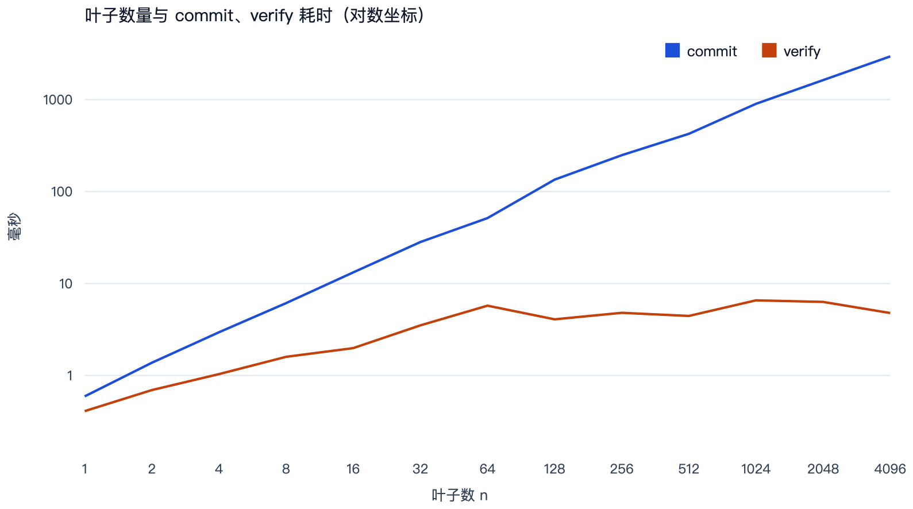

# 基于盲化 Merkle 树的向量承诺

吴青阳　2601210782

同组同学：（按实际分组填写，每组 2–3 人）

哈希函数选用 SHA-256。压缩函数、消息扩展和填充按 FIPS 180-4 实现，见 `mtc/sha256.py`。Merkle 树见 `mtc/merkle.py`。运行时不调用 `hashlib`，也不链接任何 Merkle 树库。

## 1. 方案要解决的问题

课件里已经有两个零件。

哈希承诺 `c = H(x)` 能绑定消息：在哈希抗碰撞时，承诺方事后不能把 `x` 改成另一个值再打开。它藏不住消息。`x` 的取值空间小时，验证方把所有候选代进 `H` 就能对上 `c`。课件因此改成 `c = H(x ‖ r)`，`r` 是承诺方私有的盲化因子。

Merkle 树解决另一件事：一组数据 `D_0, …, D_{n-1}` 只公开一个根，之后证明「第 `i` 个位置是某条消息」只需要从叶子走到根的兄弟节点，代价是树高，不是整组数据。

本方案把两件事叠在一起。每个位置先做带盲化因子的哈希承诺，再把这些叶子收成一棵 Merkle 树。公开的承诺只有一个 32 字节摘要。它同时约束整条向量的内容和长度。打开第 `i` 个位置时，公布该位置的消息、盲化因子和兄弟哈希。没被打开的位置仍然隐藏。

这是一个向量承诺，四个算法是：

- `Commit(D[0..n)) → (c, aux)`
- `Open(aux, i) → π`
- `Verify(c, i, D_i, π) → {0, 1}`

`aux` 只留给承诺方。验证方在打开之前只看到 `c`。

## 2. 哈希的选取

SHA-256 输出 256 bit。课件给出的通用攻击代价是生日界，碰撞安全强度 `256 / 2 = 128` bit。

选择它有两个具体原因。

第一，FIPS 180-4 公开了完整的已知答案，空串、`abc`、56 字节的多块消息、以及 100 万个 `a` 都可以直接核对。实现是否写对，不需要再调用另一份哈希代码。

第二，下面的证明不用轮函数的内部结构。Binding 只要求抗碰撞。Hiding 在随机预言机模型下只要求输出在未知盲化因子下看起来均匀。把 SHA-256 换成同样 256 bit、抗碰撞的 SM3，承诺格式和证明都可以原样保留，只需要换掉 `hash_fn`。

实现对应标准中的这几节：

- 初始链接值：前 8 个素数平方根小数部分的前 32 bit（§5.3.3）
- 轮常量：前 64 个素数立方根小数部分的前 32 bit（§4.2.2）
- 填充：补一个 `1` 位，补 `0`，再附消息的 64 bit 长度，使长度模 512 等于 448（§5.1.1）
- 压缩：64 步，每步用 `Σ`、`Ch`、`Maj` 和模 `2^32` 加法（§6.2.2）

`experiments.py` 用上述公开向量做了核对，四个向量全部一致，其中包括需要两个分组的 56 字节消息和 100 万个 `a`。增量 `update` 与一次性哈希的结果相同。

## 3. 承诺格式

记 `H` 为 SHA-256。整数编码 `⟨x⟩_64` 是 8 字节大端。盲化因子 `r_i` 从 `{0,1}^256` 均匀抽取，每个位置独立。

四种输入用首字节分开：

```text
leaf(i, r, D) = 0x00 ‖ r ‖ ⟨i⟩_64 ‖ ⟨|D|⟩_64 ‖ D
pad(j)        = 0x02 ‖ ⟨j⟩_64
node(L, R)    = 0x01 ‖ L ‖ R
commit(root, n) = 0x03 ‖ root ‖ ⟨n⟩_64
```

叶子层的宽度补到 `W = 2^{⌈log2 n⌉}`。下标 `0 .. n-1` 是真实叶子，`n .. W-1` 是填充叶子。填充位置没有消息，`Open` 和 `Verify` 都拒绝 `i ≥ n`。

内部节点两两合并，直到剩下根 `root`。对外承诺是

```text
c = H(commit(root, n))
```

多这一层是为了把向量长度 `n` 和根绑在同一个摘要里。只公开根、把 `n` 当成口头约定时，同一棵树可以对外声称不同的长度。

`n = 4` 时树的形状是：

```text
D0, r0    D1, r1    D2, r2    D3, r3
   |         |         |         |
  L0        L1        L2        L3
     \     /             \     /
      n0                   n1
          \             /
              root
               |
     c = H(0x03 ‖ root ‖ ⟨4⟩)
```

`n` 不是 2 的幂时，最右若干叶子换成 `pad(j)`，形状仍然是满二叉树。

### 3.1 Commit

输入消息 `D[0..n)`，`n ≥ 1`。

1. 若调用方没有提供盲化因子，则对每个 `i` 采样 `r_i ← {0,1}^256`。
2. `W ← 2^{⌈log2 n⌉}`。
3. 对 `i < n`，`L_i = H(leaf(i, r_i, D_i))`；对 `i ≥ n`，`L_i = H(pad(i))`。
4. 反复把当前层两两替换为 `H(node(left, right))`，得到 `root`。
5. 输出 `c = H(commit(root, n))`。承诺方保存全部消息、盲化因子和每一层节点，作为 `aux`。

哈希次数是确定的：`W` 个叶子或填充，`W - 1` 个内部节点，再加 1 次承诺头，一共 `2W` 次。`n` 为 2 的幂时就是 `2n` 次。

### 3.2 Open

输入 `aux` 和下标 `i`，要求 `0 ≤ i < n`。

从叶子层开始，令 `cursor = i`。每一层取兄弟下标 `cursor ⊕ 1`，记录兄弟哈希，以及当前节点是不是左孩子（`cursor` 为偶数就是左孩子）。然后 `cursor ← ⌊cursor / 2⌋`，直到根的下一层。

打开材料 `π` 包含：

- 下标 `i`、消息 `D_i`、盲化因子 `r_i`
- 兄弟哈希序列，长度是 `log2 W`
- 向量长度 `n`

证明里兄弟哈希占 `32 · log2 W` 字节。盲化因子另占 32 字节。消息本身还要附上，否则验证方不知道被打开的值。

这一步只做下标运算，不再哈希。

### 3.3 Verify

输入承诺 `c`、长度 `n`、打开材料 `π`。任何一项对不上就拒绝。

1. `i` 必须落在 `0 .. n-1`，`π` 里的 `n` 必须等于承诺中的 `n`。
2. 路径长度必须等于 `log2 W`，每个兄弟哈希必须是 32 字节。
3. 路径上的左右标记必须和 `i` 的二进制一致。标记是下标的函数，打开者不能靠翻转标记把同一条路径挪到别的位置。
4. 重算 `node = H(leaf(i, r_i, D_i))`。
5. 沿路径折叠：当前是左孩子时 `node = H(node(node, sibling))`，当前是右孩子时 `node = H(node(sibling, node))`。
6. 接受当且仅当 `H(commit(node, n)) = c`。

诚实执行时，第 4、5 步走出的节点和建树时相同，第 6 步的输入和 `Commit` 相同，因此一定接受。

`n = 1` 时没有兄弟，路径为空，`c = H(commit(L_0, 1))`，验证只重算叶子和承诺头。

## 4. Binding

承诺方是敌手。它想在给出 `c` 之后，对同一个位置拿出两条都能通过验证的打开，两条消息不同。

**定义。** 敌手输出 `(c, n, i, D, π, D', π')`。若 `D ≠ D'`，且

```text
Verify(c, n, i, D, π) = Verify(c, n, i, D', π') = 1
```

则它赢得绑定游戏。要求任意多项式时间敌手的获胜概率可忽略。

**定理。** 若 SHA-256 抗碰撞，则本方案满足计算性 binding。归约是紧的：多出来的开销是 `O(log n)` 次哈希，优势不超过 SHA-256 的碰撞优势。

**证明。** 四种编码的首字节不同，所以叶子、填充、内部节点、承诺头的输入集合互不相交。`leaf(i, r, D)` 对 `(i, r, D)` 是单射：索引、盲化因子、长度和消息字节都写在输入里，不同的消息对应不同的字节串。

两条打开都通过验证，因此它们各自算出一条哈希链，终点都是同一个 `c`，链长都是 `log2 W + 1`（路径上的内部节点，再加承诺头）。叶子编码记为 `x` 和 `x'`。由 `D ≠ D'` 和单射，`x ≠ x'`。

从叶子往终点看，存在第一处「输入不同、输出相同」：

- 若第一处就是叶子，则 `H(x) = H(x')` 且 `x ≠ x'`，这是 SHA-256 的碰撞。
- 若叶子哈希已经不同，则两条链在后面某一层才第一次汇合。那一层的输入是某个 `node(·, ·)` 或最终的 `commit(·, n)`。两边输入不同、哈希相同，仍然是碰撞。

汇合层一定存在，因为两条链的终点都等于 `c`。归约算法运行敌手，按验证过程把两条链重算出来，输出这一对输入。它不需要额外的密码学能力。

因此

```text
Adv_binding ≤ Adv_collision(SHA-256)
```

对 SHA-256 的通用碰撞攻击是生日攻击，大约 `2^128` 次哈希，和课件给出的 128 bit 安全强度一致。

这个性质是计算性的。256 bit 的输出上碰撞必然存在，只是找不到。下面的实验把输出截短以后，碰撞立刻变成一条具体的伪打开，用来核对归约的方向：绑定一旦被打破，手上就有 `H` 的一组碰撞。

索引写进叶子之后，同一份 `(D, r)` 不能拿到另一个下标再用。叶子输入已经变了，原打开过不了验证。长度写进承诺头之后，改 `n` 会改变承诺头的输入；在没有碰撞时，同一个 `c` 不能对应两个长度。

### 4.1 弱哈希上的具体碰撞

把同一个 `Scheme` 的哈希换成 `experiments.py` 里的 `toy16`。它输出 16 bit，碰撞安全强度只剩大约 8 bit，其他编码、建树、验证都不变。

生日搜索在 664 次叶子哈希后找到：

```text
H16(leaf(0, r_yes, "yes")) = H16(leaf(0, r_no, "no")) = 2b1f
r_yes = 000000f3
r_no  = 00000298
```

两条叶子编码不同，因为消息不同。用 `("yes", r_yes)` 生成承诺后，`("no", r_no)` 的打开也能通过验证。这就是绑定失败，同时还是 `H16` 的一组碰撞，和上一节的归约对得上。

同一搜索换回 SHA-256，替换 4096 个盲化因子，试图把 `yes` 打开成 `no`，成功次数是 0。这只说明实现里没有明显的绑定漏洞，不是对 128 bit 强度的实验证明。

## 5. Hiding

验证方是敌手。它想在打开之前判断承诺里装的是哪条消息。

**定义。** 敌手先提交两个等长向量 `D^{(0)}`、`D^{(1)}`，以及一组将要打开的位置 `Q`。两个向量在 `Q` 上的消息必须相同，否则打开本身就会暴露比特。挑战者抽取 `b ← {0,1}`，承诺 `D^{(b)}`，把 `c` 和 `Q` 上的打开交给敌手。敌手猜 `b`。优势可忽略则称方案具有选择性打开下的 hiding。

### 5.1 没有盲化因子时不成立

盲化因子取全 0 时，叶子是消息的确定性函数。实验把消息限制在 32 个单字节里，承诺其中一个。穷举这 32 个候选，用同一个全 0 盲化因子重算承诺，一次就对上了原消息。这就是课件里说的穷举和彩虹表：消息空间小，`H(x)` 藏不住 `x`。

### 5.2 随机预言机下的论证

把 `H` 看成随机预言机。未打开位置的盲化因子是 256 bit 均匀随机数，而且不会出现在打开材料里。敌手查询随机预言机 `q` 次。对某一个未打开叶子，它猜中 `r_i` 并查询到完整叶子输入的概率不超过 `q / 2^256`。没猜中时，这个叶子在它眼里是一条新的均匀随机串，和该位置的消息无关。

模拟器按这个观察构造与 `b` 无关的视图：

- `Q` 上的位置，两个向量的消息相同，模拟器用同一组真实盲化因子计算叶子。
- `Q` 以外的叶子换成均匀随机的 32 字节串。
- 内部节点、根、承诺头、以及打开路径上的兄弟哈希，都从这些叶子如实往上算。

除了猜中某个未打开盲化因子的情况，这个视图在 `b = 0` 和 `b = 1` 下相同。失败概率不超过 `n · q / 2^256`，可忽略。

因此没被打开的位置是隐藏的。已经被打开的位置会公布消息和盲化因子，这是 `Open` 的定义，不是泄漏。兄弟哈希是子树的摘要。在随机预言机下，它不比「一条随机串」多给出子树里的消息。

Hiding 也是计算性的。盲化因子只有 256 bit，猜 `r` 在原则上可行，代价是 `2^256` 量级。

### 5.3 分布实验

用真实 SHA-256 做了 200 对独立承诺，比较承诺摘要的汉明距离。两条独立均匀 256 bit 串的期望距离是 128 bit。

| 比较 | 平均汉明距离 |
|---|---:|
| 消息 `yes` 与 `no`，各自独立盲化 | 128.28 |
| 消息同为 `yes`，盲化因子独立 | 126.75 |
| 均匀随机串的期望 | 128 |

两种承诺在统计上叠在一起：只看 `c`，区分不了消息变了还是只换了盲化因子。盲化之后再用全 0 盲化因子去穷举那 32 个候选，命中 0 次。

## 6. 和 Merkle-Damgård 长度扩展的关系

SHA-256 是 Merkle-Damgård 结构。课件里的长度扩展是：知道 `H(M)` 和 `|M|`，可以在不知道 `M` 的情况下计算 `H(M ‖ pad ‖ 后缀)`。如果叶子和内部节点用同一种拼接，攻击者有机会把一种节点的编码解释成另一种。

本方案每次哈希都从初始链接值重新开始，输入以域字节开头。长度扩展得到的是「原输入再接一段填充和后缀」的哈希，字节格式对不上 `leaf`、`node`、`pad`、`commit` 中的任何一种，不能直接当成一个新的合法父节点。验证方也不会把收到的摘要当作链接值继续压缩，而是重新计算 `H(0x01 ‖ left ‖ right)`。

域分离不代替抗碰撞。它去掉的是「换一种语法角色」这种结构化伪造，剩下的伪造仍然要碰到 `H` 的碰撞，从而落回第 4 节的归约。

## 7. 一个可复现的打开

四条消息 `Alice`、`Bob`、`Carol`、`Dave`。盲化因子取常数值，便于重算：第 `i` 个盲化因子是字节 `i+1` 重复 32 次。

```text
c = 2eb5cf4fea2c4063f4934a3613da01833bc70eec6e19d431e8596167112da02d
```

打开下标 2，消息是 `Carol`。路径两步：

| 步骤 | 当前节点 | 兄弟哈希 |
|---|---|---|
| 1 | 左孩子 | `3f21a814c0e916cb21876e8d51f9047e72ef7df0ba25460316b43c4b5be65785` |
| 2 | 右孩子 | `9f1fe00a77346a0644dea3394288ce35b325a139c94046c1ba1c0912850a7ce8` |

第一步的兄弟是 `Dave` 的叶子，第二步的兄弟是 `Alice` 与 `Bob` 的父节点。诚实打开验证通过。把消息改成 `Eve`、盲化因子和路径都不变，验证拒绝。

## 8. 性能

测量环境：macOS 15.5，arm64，Python 3.10.7。时间取若干次的中位数。原始数据在 `results/metrics.json`，图在 `results/timing.svg`。纯 Python 的墙钟时间会随机器负载浮动，哈希次数不会。

### 8.1 SHA-256 本身

长消息上吞吐大约 0.33 MiB/s。100 万个 `a` 的单次测量是 2.936 s，约 0.32 MiB/s，和这张表一致。

| 消息长度 | 耗时 | 吞吐 |
|---:|---:|---:|
| 64 B | 0.337 ms | 0.181 MiB/s |
| 1 KiB | 2.878 ms | 0.339 MiB/s |
| 4 KiB | 12.545 ms | 0.311 MiB/s |
| 32 KiB | 88.637 ms | 0.353 MiB/s |
| 256 KiB | 748.202 ms | 0.334 MiB/s |

64 字节这一档更慢，是因为一次哈希的 Python 调用和填充在短消息上占了大头。Merkle 树的叶子都是短消息，所以方案的开销应该按哈希次数算，而不是按消息字节数除以这张表的吞吐。

一次压缩是 64 步移位、异或和模 `2^32` 加法。这些步骤在解释器里逐条执行。C 语言实现的 SHA-256 通常是每秒数百 MiB。两边的差距来自解释器，不来自承诺的层数。把同一套 `Commit` / `Verify` 接到更快的 SHA-256 上，commit 和 verify 会按同一个倍数加速，下面的次数比保持不变。

### 8.2 树的规模

叶子内容是 `tx-00000000` 这种短字节串。`n` 取 2 的幂，因此 `W = n`，没有填充。`Open` 不哈希，测得都在 0.02 ms 以下，相对 verify 可以忽略。

| n | commit | verify | 证明 | commit 次数 | verify 次数 |
|---:|---:|---:|---:|---:|---:|
| 1 | 0.591 ms | 0.409 ms | 0 B | 2 | 2 |
| 2 | 1.373 ms | 0.692 ms | 32 B | 4 | 3 |
| 4 | 2.942 ms | 1.034 ms | 64 B | 8 | 4 |
| 8 | 6.114 ms | 1.591 ms | 96 B | 16 | 5 |
| 16 | 13.200 ms | 1.983 ms | 128 B | 32 | 6 |
| 32 | 28.262 ms | 3.497 ms | 160 B | 64 | 7 |
| 64 | 51.429 ms | 5.740 ms | 192 B | 128 | 8 |
| 128 | 134.675 ms | 4.073 ms | 224 B | 256 | 9 |
| 256 | 248.149 ms | 4.797 ms | 256 B | 512 | 10 |
| 512 | 425.175 ms | 4.439 ms | 288 B | 1024 | 11 |
| 1024 | 900.228 ms | 6.551 ms | 320 B | 2048 | 12 |
| 2048 | 1629.231 ms | 6.296 ms | 352 B | 4096 | 13 |
| 4096 | 2950.469 ms | 4.773 ms | 384 B | 8192 | 14 |

次数是精确值，测试对 `n = 1, 2, 3, 5, 8, 100` 做了断言：commit 一定是 `2W` 次，其中非 2 的幂会把填充叶子也算进去。

Commit 的墙钟时间和哈希次数成正比。4096 个叶子是 8192 次哈希、2950 ms，大约每次哈希 0.36 ms。从 `n = 8`（16 次，6.11 ms）到 `n = 4096`，哈希次数变为 512 倍，时间变为 483 倍。

Verify 只有 `log2 n + 2` 次哈希。4096 个叶子是 14 次，按 commit 测得的每次 0.36 ms 估计，大约 5.0 ms，实测 4.77 ms。次数比 `8192 / 14 ≈ 585`，时间比 `2950 / 4.77 ≈ 618`。两者相符：验证比把整棵树重算一遍快大约三个数量级。

Verify 一列在 4 ms 到 7 ms 之间有跳动，是因为这些调用总共只有几毫秒，和调度噪声同一量级，而哈希次数从 7 次涨到 14 次也只是两倍。这一列不适合拿来拟合曲线。稳定的复杂度是次数，稳定的墙钟对照是 `n = 4096` 这一行。

证明大小只跟树高有关。4096 条叶子的兄弟哈希是 384 字节，和单条消息有多长无关。这是用 Merkle 树而不是把每个叶子哈希都发给验证方的原因。

图中 commit 随叶子数上升，verify 停在数毫秒。横轴是叶子数，纵轴是毫秒，坐标为对数。



## 9. 正确性测试覆盖了什么

- SHA-256 的四个 FIPS 已知答案，以及 0、1、55、56、63、64、65、128 字节上的增量哈希。55 字节约好放进一个分组，56 字节必须拆成两个分组。
- `n = 1, 2, 3, 4, 5, 7, 8, 17` 的每一个位置都能打开并通过验证。其中包含空消息和 10 KB 的叶子，也包含不是 2 的幂的长度。
- 篡改消息、盲化因子、兄弟哈希、下标或向量长度，验证都拒绝。把位置 3 的消息配上位置 1 的路径，也拒绝。
- 相同消息、相同盲化因子得到相同承诺。只改一个盲化因子，承诺改变。空向量被拒绝。

## 10. 局限

随机预言机是对 SHA-256 的理想化。在标准模型里，hiding 需要更强的假设，例如把盲化因子当密钥时叶子哈希像一个伪随机函数。本方案沿用课件对 `H(x ‖ r)` 的论证方式。

Binding 的 128 bit 是经典生日界。通用量子碰撞攻击的代价大约是 `2^{256/3}`，约 `2^85` 次。本方案没有把哈希换成抗量子的结构。

承诺方需要保存整棵树才能打开，空间是 `Θ(n)`。验证方只保存 32 字节的 `c`，打开时收到 `O(log n)` 的证明。

`n` 不是 2 的幂时，叶子层会补到下一个 2 的幂。`n = 5` 时 `W = 8`，commit 做 16 次哈希，比刚好满的 4 叶子树多一倍。这是满二叉树的代价，次数公式已经把它算进去了。

向量长度 `n` 是公开的。Hiding 隐藏的是各位置的消息，不隐藏有多少条。

## 11. 结论

承诺是课件中的盲化哈希承诺，再用 Merkle 树收成一个摘要，并用域字节和长度头去掉节点角色混淆。

Binding 归约到 SHA-256 的抗碰撞性，经典安全强度 128 bit。把哈希输出降到 16 bit 后，664 次尝试就得到两条都验证通过的不同消息，归约方向和实现一致。

Hiding 来自每个叶子上独立的 256 bit 盲化因子。不盲化时，32 个候选会被穷举恢复；盲化后，承诺摘要的汉明距离落在 128 bit 附近，穷举对不上。

Commit 做 `2W` 次哈希，Verify 做 `log2 W + 2` 次。4096 个叶子时，证明 384 字节，验证大约比整树重算快 600 倍。当前纯 Python 实现大约每次哈希 0.36 ms，吞吐约 0.33 MiB/s，瓶颈在解释执行的压缩函数。

## 参考文献

1. FIPS 180-4, *Secure Hash Standard (SHS)*, NIST.
2. Ralph C. Merkle. *A Digital Signature Based on a Conventional Encryption Function.* CRYPTO 1987.
3. 课程课件中的哈希承诺 `H(x)`、`H(x ‖ r)` 与 Merkle Hash Trees。
